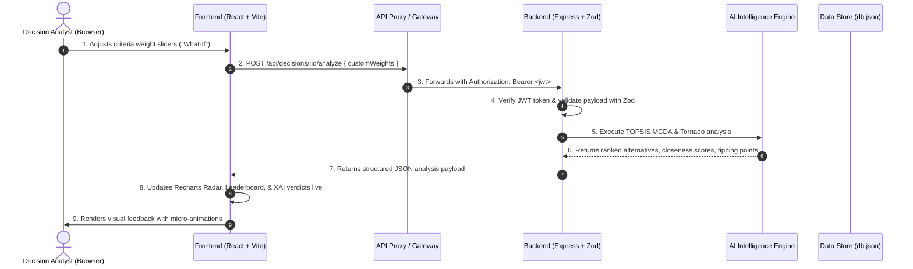

# Stratagem AI | Architecture & Separation of Concerns

This document details the boundary, separation of concerns, communication contract, and execution differentiation between the **Frontend (`/client`)** and the **Backend (`/server`)** in the Stratagem Decision Intelligence platform.

---

## 🧭 High-Level Comparison Matrix

| Dimension | Frontend (`/client`) | Backend (`/server`) |
| :--- | :--- | :--- |
| **Runtime Environment** | Web Browser (V8, SpiderMonkey, WebKit) | Node.js Runtime (v18+) |
| **Port / Base URL** | `http://localhost:3000` | `http://localhost:5000` |
| **Primary Framework** | React.js (v18) + Vite (v6) | Express.js (v4) |
| **Styling & Icons** | Tailwind CSS + Lucide Icons | N/A (Headless REST JSON) |
| **Visual Analytics** | Recharts (Radar, Area, Bar, Tornado) | N/A |
| **Data Validation** | Form UX states & client-side bounds | Strict **Zod** schema gatekeeper |
| **Security & Auth** | Stores JWT token in `localStorage`, injects `Bearer <token>` via Axios interceptor | Signs and verifies JWT, hashes passwords with **bcryptjs** (salt 10) |
| **Algorithmic Core** | Consumes results, drives interactive sliders, renders probability curves | **TOPSIS vector normalization**, **Monte Carlo stochastic simulator**, **Tornado sensitivity swings**, **XAI synthesis** |
| **Persistence** | Session cache / React memory state | File-backed JSON database (`/server/data/db.json`) with atomic sync |
| **Build Artifact** | Static SPA bundle (`index.html`, CSS, JS chunks) | Node.js executable application (`src/index.js`) |
| **Target Deployment** | CDN / Static Hosting (Vercel, Netlify, Cloudflare Pages, S3) | Container / Server Runtime (Docker, Render, AWS ECS, GCP Cloud Run) |

---

## 📁 Directory Boundary Breakdown

```
build to ship project/
│
├── client/                              # FRONTEND APPLICATION
│   ├── public/                          # Static browser assets
│   ├── src/
│   │   ├── api/
│   │   │   └── client.js                # Axios instance with JWT interceptor & baseURL
│   │   ├── context/
│   │   │   └── AuthContext.jsx          # User session, login, register, demo auth state
│   │   ├── components/                  # Reusable UI components
│   │   │   ├── Navbar.jsx               # Top navigation & engine status badge
│   │   │   ├── StatCard.jsx             # Glowing metric summary cards
│   │   │   ├── DecisionRadarChart.jsx   # Multi-criteria Recharts radar chart
│   │   │   ├── MonteCarloDistributionChart.jsx # Area chart probability density curves
│   │   │   ├── TornadoChart.jsx         # Horizontal bar chart for sensitivity leverage
│   │   │   ├── SensitivitySliders.jsx   # Live "What-If" interactive weight simulator
│   │   │   ├── IngestModal.jsx          # CSV upload, paste, & sample templates modal
│   │   │   ├── NewDecisionModal.jsx     # Multi-variable scenario creation wizard
│   │   │   └── ExplainableBriefModal.jsx# Board-ready executive brief export view
│   │   ├── pages/                       # Primary view routes
│   │   │   ├── Login.jsx                # Sign-in view with 1-click Demo Login
│   │   │   ├── Register.jsx             # Analyst registration view
│   │   │   ├── Dashboard.jsx            # Strategic decision catalog & stats
│   │   │   └── DecisionWorkspace.jsx    # Multi-tab decision studio
│   │   ├── App.jsx                      # React Router configuration & ProtectedRoutes
│   │   ├── index.css                    # Tailwind directives & glassmorphism utilities
│   │   └── main.jsx                     # Vite React root mount
│   ├── .env.example                     # VITE_API_BASE_URL
│   ├── tailwind.config.js               # Theme colors, typography, glowing shadows
│   └── vite.config.js                   # Vite dev server & proxy to backend
│
├── server/                              # BACKEND REST SERVICE
│   ├── data/
│   │   └── db.json                      # Persistent database file with atomic writes
│   ├── src/
│   │   ├── config/
│   │   │   └── env.js                   # Port, JWT secret, CORS, environment variables
│   │   ├── db/
│   │   │   └── store.js                 # Database persistence layer & enterprise seed data
│   │   ├── engine/                      # AI DECISION INTELLIGENCE CORE
│   │   │   ├── mcda.js                  # TOPSIS, WSM, and Pareto dominance algorithms
│   │   │   ├── monteCarlo.js            # Stochastic risk simulation (1k-10k runs, VaR 95%)
│   │   │   ├── sensitivity.js           # Multi-weight perturbations & tipping points
│   │   │   └── explainableAi.js         # Trade-off insights & strategic action planning
│   │   ├── schemas/                     # ZOD VALIDATION LAYER
│   │   │   ├── auth.schema.js           # Strict auth request schemas
│   │   │   └── decision.schema.js       # Strict decision payload & simulation schemas
│   │   ├── middleware/
│   │   │   ├── auth.middleware.js       # JWT extraction & signature verification
│   │   │   ├── validate.middleware.js   # Generic Zod validation middleware
│   │   │   └── error.middleware.js      # Global error handler returning standard JSON
│   │   ├── controllers/
│   │   │   ├── auth.controller.js       # Register, login, demoLogin, getProfile
│   │   │   └── decision.controller.js   # Decision CRUD, analysis, simulation, CSV ingest
│   │   ├── routes/
│   │   │   ├── auth.routes.js           # /api/auth/*
│   │   │   ├── decision.routes.js       # /api/decisions/*
│   │   │   └── api.js                   # Master API router (/api/health, /api/*)
│   │   └── index.js                     # Express app setup, CORS, JSON parser, listener
│   ├── test/                            # AUTOMATED BACKEND TEST SUITE
│   │   ├── decision-engine.test.js      # TOPSIS, Monte Carlo, Tornado, & XAI unit tests
│   │   └── api-integration.test.js      # Auth, CRUD, simulation, & CSV integration tests
│   └── .env.example                     # PORT, JWT_SECRET, CORS_ORIGIN
│
└── package.json                         # Root monorepo workspace scripts
```

---

## 🔄 The Data Flow & Communication Contract



---

## 🔒 Security Boundary Enforcement

1. **Client Isolation**:
   - The browser never has access to the `JWT_SECRET` or database credentials.
   - Secrets are never bundled into the Vite production build (`VITE_` variables are only for public configuration).
   - The frontend merely holds a bearer token in storage and presents it for verification.

2. **Server Enforcement**:
   - Every protected route passes through `authenticate` middleware.
   - All input bodies, parameters, and query strings pass through strict `Zod` schemas before touching database or computation logic.
   - Password comparison is executed exclusively via cryptographic `bcrypt.compare`.

---

## 🚀 Independent Execution & Deployment

### Run Locally:
- **Both Concurrently**: `npm run dev` (from root)
- **Frontend Only**: `npm run dev:client` (serves on `http://localhost:3000`)
- **Backend Only**: `npm run dev:server` (serves on `http://localhost:5000`)

### Independent Production Deployment:
1. **Frontend**:
   ```bash
   cd client
   npm install
   npm run build
   # Output in client/dist/ is pure static HTML/JS/CSS.
   # Deploy directly to Vercel, Netlify, Cloudflare Pages, or AWS S3 + CloudFront.
   # Set VITE_API_BASE_URL to point to your live backend domain.
   ```
2. **Backend**:
   ```bash
   cd server
   npm install
   node src/index.js
   # Deploy to Docker, Render, AWS ECS, GCP Cloud Run, or Railway.
   # Provide PORT, JWT_SECRET, and CORS_ORIGIN environment variables.
   ```
