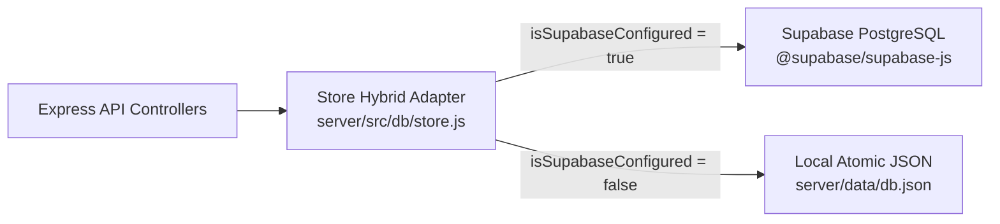

# Stratagem AI | Supabase Connection & Setup Guide

Supabase support is integrated into Stratagem AI via the official `@supabase/supabase-js` SDK with an automatic **Hybrid Adapter Pattern**:
- When Supabase credentials are provided in `.env`, the system automatically connects to your Supabase PostgreSQL cloud database with Row Level Security (RLS).
- If credentials are not set, the platform automatically falls back to local file persistence (`db.json`) so development and testing continue with zero downtime.

---

## 🚀 3-Step Setup Instructions

### Step 1: Run the Database Schema in Supabase
1. Open your [Supabase Dashboard](https://supabase.com/dashboard).
2. Create a new project (or select an existing one).
3. Navigate to **SQL Editor** in the left sidebar.
4. Copy the entire contents of [`supabase/schema.sql`](./supabase/schema.sql) and paste it into the editor.
5. Click **Run**. This will create:
   - `public.users` table with email index
   - `public.decisions` table with jsonb parameters and indexes
   - Row Level Security (RLS) policies
   - Pre-seeded enterprise benchmark decision scenarios and demo analyst account

---

### Step 2: Configure Environment Variables
1. In your Supabase Dashboard, go to **Project Settings** (gear icon) -> **API**.
2. Copy your **Project URL**, **anon public key**, and **service_role key**.
3. Create a `server/.env` file (copying from `server/.env.example`):

```env
PORT=5000
NODE_ENV=development
JWT_SECRET=your-secure-jwt-secret-key-here
CORS_ORIGIN=*

# Paste your Supabase credentials here:
SUPABASE_URL=https://xxxxxxxxxxxx.supabase.co
SUPABASE_ANON_KEY=eyJhbGciOiJIUzI1NiIsInR5cCI6IkpXVCJ9...
SUPABASE_SERVICE_ROLE_KEY=eyJhbGciOiJIUzI1NiIsInR5cCI6IkpXVCJ9...
```

*(Optional: If you also want client-side direct Supabase access, paste your `VITE_SUPABASE_URL` and `VITE_SUPABASE_ANON_KEY` in `client/.env`)*

---

### Step 3: Verify the Connection Handshake
Run the built-in Supabase diagnostic test tool:

```bash
npm run test:supabase --workspace=server
```

When connected properly, you will see:
```
--- Stratagem AI: Supabase Connection Verification ---
Attempting handshake with Supabase project...
Connection Successful!
Connected to Supabase PostgreSQL. Users table verified.
```

---

## 🗄️ Architecture Overview



- **Zero-Downtime Resilience**: If you ever remove or change credentials, the platform seamlessly defaults back to the local database without throwing unhandled exceptions.
- **Data Integrity**: All PostgreSQL queries map snake_case columns (`user_id`, `created_at`) to the application's clean camelCase models (`userId`, `createdAt`).
